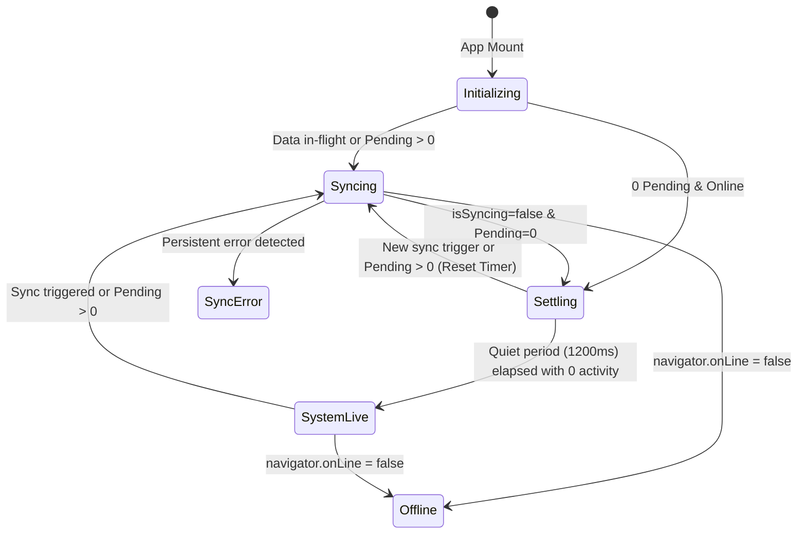

# Implementation Plan: UI-Only Continuous Sync Stabilization for "System Live" Badge

## 1. Problem Statement & User Objective
- **Current Behavior**: During network micro-bursts, navigation, or multi-collection snapshot handshakes, the top status badge can briefly alternate between `"Syncing..."` and `"System Live"`. Even though database operations are healthy, the rapid visual toggle creates a perceived flicker.
- **Goal**: Mask intermittent background sync micro-cycles completely in the frontend presentation layer. The badge should display a continuous, steady loading state until all background operations fully settle, transitioning to `"System Live"` only after a sustained quiet period.
- **Constraint**: Zero backend changes. Firestore sync, IndexedDB persistence, cost calculations in [`src/lib/billing.js`](file:///f:/BSCS%20-%20III/WORK%20WORK%20WORK/keana/PPCMS-WEB/src/lib/billing.js), and event dispatchers remain completely untouched.

---

## 2. UI/UX Intelligence & Agent Skill Alignment
Following **`ui-ux-pro-max`** and **`ppcms-refactor`** guidelines:
1. **Feedback & Loading Timing** (`ui-ux-pro-max` Guideline #1):
   - Prevent micro-flashes by establishing a minimum hold time (600ms) whenever a sync/loading state is displayed.
   - Avoid abrupt state flipping by utilizing a stabilization window (1,200ms) before committing the transition to `"System Live"`.
2. **Cancellable Transitions** (`ui-ux-pro-max` Guideline #3):
   - If a new sync payload or pending item is detected during the stabilization window, cancel the scheduled transition and seamlessly retain the loading state.
3. **Accessibility & Semantic Correctness**:
   - Preserve `role="status"` and `aria-atomic="true"` for non-disruptive screen reader announcements.
   - Maintain interactive retry capability on sync errors.
4. **PPCMS Architectural Rules** (`ppcms-refactor`):
   - Strict component scope: confined entirely inside [`src/components/ui/connectivity-badge.jsx`](file:///f:/BSCS%20-%20III/WORK%20WORK%20WORK/keana/PPCMS-WEB/src/components/ui/connectivity-badge.jsx).
   - Zero side-effects on mathematical formulas or IndexedDB transactions.

---

## 3. Architecture & State Machine



### State Machine Specification:
- **`UI_STATE.INITIALIZING`**: Display `"Connecting..."` on initial mount until first status event is evaluated.
- **`UI_STATE.SYNCING`**: Display continuous `"Syncing changes..."` or `"Syncing (N)..."` with a subtle animated pulse dot.
- **`UI_STATE.SETTLING`**: Continue displaying `"Finalizing..."` or keep the sync indicator steady for a debounced grace period (1,200ms).
- **`UI_STATE.LIVE`**: Display `"System Live"` with emerald accent badge once all queues and snapshots have remained idle for the full duration.
- **`UI_STATE.OFFLINE`**: Display `"Offline Mode"` / `"Offline (N pending)"`.
- **`UI_STATE.ERROR`**: Display `"Sync Issue (Retry)"` with click-to-retry handler.

---

## 4. Implementation Steps

### Step 1: Implement `useStabilizedSyncState` Hook
- File: [`src/components/ui/connectivity-badge.jsx`](file:///f:/BSCS%20-%20III/WORK%20WORK%20WORK/keana/PPCMS-WEB/src/components/ui/connectivity-badge.jsx)
- Encapsulate the stabilization state machine using `useRef` for timer management (`settleTimerRef`, `minHoldTimerRef`).
- Parameters:
  - `SETTLE_DELAY_MS = 1200`: Duration the system must remain completely quiet before switching to `"System Live"`.
  - `MIN_HOLD_MS = 600`: Minimum duration the syncing visual state is held once triggered to prevent sub-second visual flashes.

### Step 2: Update Badge Presentation & Styling
- File: [`src/components/ui/connectivity-badge.jsx`](file:///f:/BSCS%20-%20III/WORK%20WORK%20WORK/keana/PPCMS-WEB/src/components/ui/connectivity-badge.jsx)
- Use standard design tokens matching the existing theme (`var(--primary)`, Tailwind `#ecfdf5`, `#059669`).
- Add CSS transition `opacity 0.25s ease, transform 0.25s ease` for seamless cross-fade between states without layout jumps.

### Step 3: Automated Verification with Playwright & Vitest
1. **Vitest Unit Test Suite**:
   ```bash
   npm run test
   ```
   Confirm all equations in [`src/lib/billing.js`](file:///f:/BSCS%20-%20III/WORK%20WORK%20WORK/keana/PPCMS-WEB/src/lib/billing.js) remain 100% passing.
2. **Playwright E2E Verification**:
   - Update [`tests/e2e-check.mjs`](file:///f:/BSCS%20-%20III/WORK%20WORK%20WORK/keana/PPCMS-WEB/tests/e2e-check.mjs) Check 4 to sample the badge over 6 seconds during concurrent database mutations.
   - Confirm **0 visual flickers** and smooth single-transition convergence to `"System Live"`.
   - Take and attach verification screenshots.

---

## 5. Review & Approval
Please review this plan. Upon your confirmation, execution will begin immediately.
